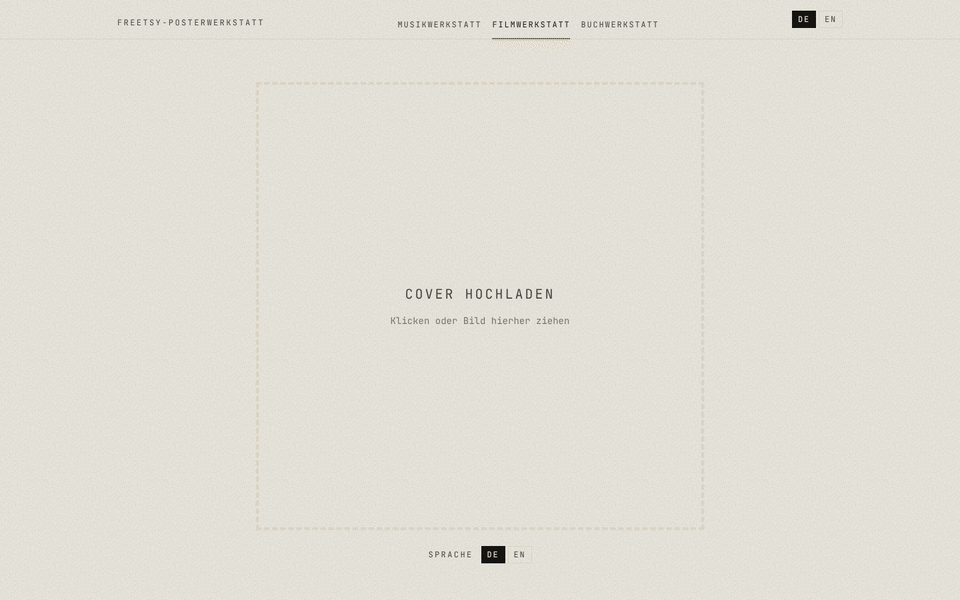
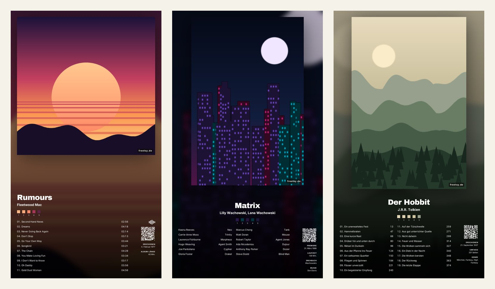
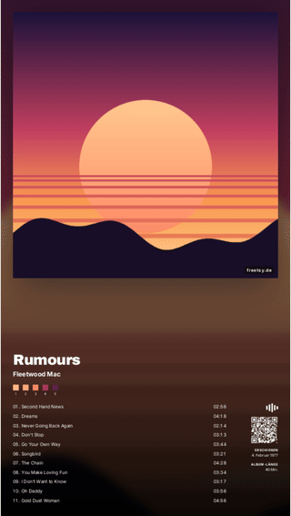

<div align="center">

# Nicominecith Poster

**Aus Album, Film oder Buch ein druckfertiges Poster, direkt im Browser. Cover kommen automatisch.**

von **Nicominecith_clips** · Music · Film · Books





</div>

## ✨ What it does

- 🖼️ **Auto covers (new).** Pick an album, film or book and the cover is fetched for you (iTunes, Wikidata/Commons, Wikipedia, Open Library). No upload needed, your own image stays optional.
- ⚙️ **Settings (new).** Language, light/dark theme and auto-cover switch, saved on your device only.
- 📱 **Phone, tablet and PC** layouts.

- 🎵 **Three workshops.** Albums come with their tracklist, films with their cast and awards, and books with their chapters, characters and first lines.
- 🔎 **Search fills everything in.** Titles, dates, runtimes, credits and summaries come from iTunes, MusicBrainz, Wikidata, Wikipedia and Open Library, and every field stays editable.
- 🖼️ **Your own cover.** You upload and crop it (square or 2:3) and it never leaves your browser. The colour palette is taken from it.
- 🎨 **Eight styles plus free design.** You can tune sizes, fonts, colours and spacing, and pick colours straight off the poster with a pipette.
- 🔗 **QR or Spotify code** pointing to the album, film or book.
- 🖨️ **Print-ready export** from social media size up to A1 at 600 DPI, as JPG or PDF, rendered by Rust compiled to WebAssembly.
- 🌍 **Every script.** Arabic, Hebrew, Devanagari, CJK, emoji and more are shaped and printed correctly.
- 🍪 **No cookies, no tracking, no account.** The interface is in German and English.

<table>
  <tr>
    <td></td>
    <td>
      <b>Bloom · Classic · Gallery · Mono · Noir · Onyx · Paper · Sand</b><br /><br />
      Each style is a complete layout. Switch freely, or enable <i>Selber basteln</i> to take over
      every size, font and colour yourself.
    </td>
  </tr>
</table>

## 🚀 Getting started

Requires [Bun](https://bun.sh) 1.4.

```sh
bun install
bun run dev        # http://localhost:3000 (film at /film/, books at /buch/)
```

| Command              | What it does                                                                   |
| -------------------- | ------------------------------------------------------------------------------ |
| `bun run build`      | Builds all workshops into `dist/site`.                                         |
| `bun run test`       | Runs the tests of every project.                                               |
| `bun run typecheck`  | Type-checks every project.                                                     |
| `bun run lint`       | Lints every project and enforces module boundaries.                            |
| `bunx nx graph`      | Opens the project graph.                                                       |
| `bun run build:wasm` | Rebuilds the renderer. Needs Rust and `wasm-bindgen`; the output is committed. |
| `bun run rust:test`  | Runs the renderer's Rust tests and pixel snapshots.                            |

## 🧱 How it's built

An [Nx](https://nx.dev) monorepo: one small app per workshop on top of shared libraries.

```
apps/
  music · film · book    one Vite app per workshop
  site                   assembles the apps for Firebase Hosting
libs/
  workshop               shared poster workbench, routing and pages
  poster                 poster model, layout and themes
  renderer               Rust → WebAssembly renderer, export and PDF
  catalog                typed search adapters (Wikidata, Wikipedia, …)
  ui · styles            shadcn/ui components and Tailwind design tokens
  fonts · i18n · utils   fonts, translations and helpers
tools/
  vite · workspace-plugin   shared Vite config and Nx generators
```

- ⚛️ **Frontend:** React 19, TanStack Router, Query and Form, Tailwind CSS 4, shadcn/ui
- 🦀 **Renderer:** Rust with tiny-skia and rustybuzz, compiled to WebAssembly and run in Web Workers
- 🧪 **Quality:** strict TypeScript, ESLint with Nx module boundaries, Prettier, Clippy, bun test, and pixel snapshots for the renderer

## ➕ Adding a workshop

A workshop is a search adapter plus a few mappings. The generator scaffolds a new one and wires it
into Vite, the site build and Firebase:

```sh
bunx nx g @freetsy/workspace-plugin:workshop games --base=/spiele/
```

Then fill in `search` and `detail` in `apps/games/src/games-workshop.tsx`, following
`apps/film`.

## 🏠 Running your own instance

Operator details and branding are not in the code. They are read at build time, so a fork never
shows someone else's imprint:

| Variable            | Used for                                                                  |
| ------------------- | ------------------------------------------------------------------------- |
| `VITE_SITE_OWNER`   | Imprint, privacy policy, footer and page headers                          |
| `VITE_SITE_ADDRESS` | Postal address in the imprint and privacy policy, lines separated by `\|` |
| `VITE_SITE_EMAIL`   | Contact address in the imprint and privacy policy                         |
| `VITE_POSTER_BRAND` | Label printed on social media posters; leave empty for none               |

- 💻 **Locally:** copy `.env.example` to `.env` in the repository root.
- ☁️ **Deploys:** the Firebase workflows read the `SITE_OWNER`, `SITE_ADDRESS`, `SITE_EMAIL` and `POSTER_BRAND` repository variables, and refuse to deploy without the first three.
- ⚠️ **Without them**, the legal pages say that no operator is configured.
- 📝 **Your responsibility:** the legal texts describe freetsy.de. Whoever runs an instance is responsible for it and needs their own imprint, privacy policy and terms.

## 📄 Data and licences

- 📚 **Search data:** Wikidata (CC0), MusicBrainz (CC0), Open Library and the iTunes Search API. Wikipedia summaries are CC BY-SA 4.0 and are credited on the poster.
- 🔤 **Fonts:** the licences of the bundled fonts are listed in [`libs/fonts/assets/NOTICE.md`](libs/fonts/assets/NOTICE.md).
- 🖼️ **Covers:** you upload covers yourself; Freetsy ships no cover art.

## ⚖️ License

[AGPL-3.0](LICENSE). You may use, change and host Freetsy, as long as you publish your changes
under the same license, including when you only run it as a website.

The license covers the code, not the name „Freetsy“ or the freetsy.de brand (AGPL-3.0 § 7e).
Please run your instance under a name of your own.


## Credits

Nicominecith Poster is made by **Nicominecith_clips**. It is a modified version of [Freetsy](https://github.com/Leftwitch/Freetsy) and stays under AGPL-3.0, see `NOTICE.md`.
